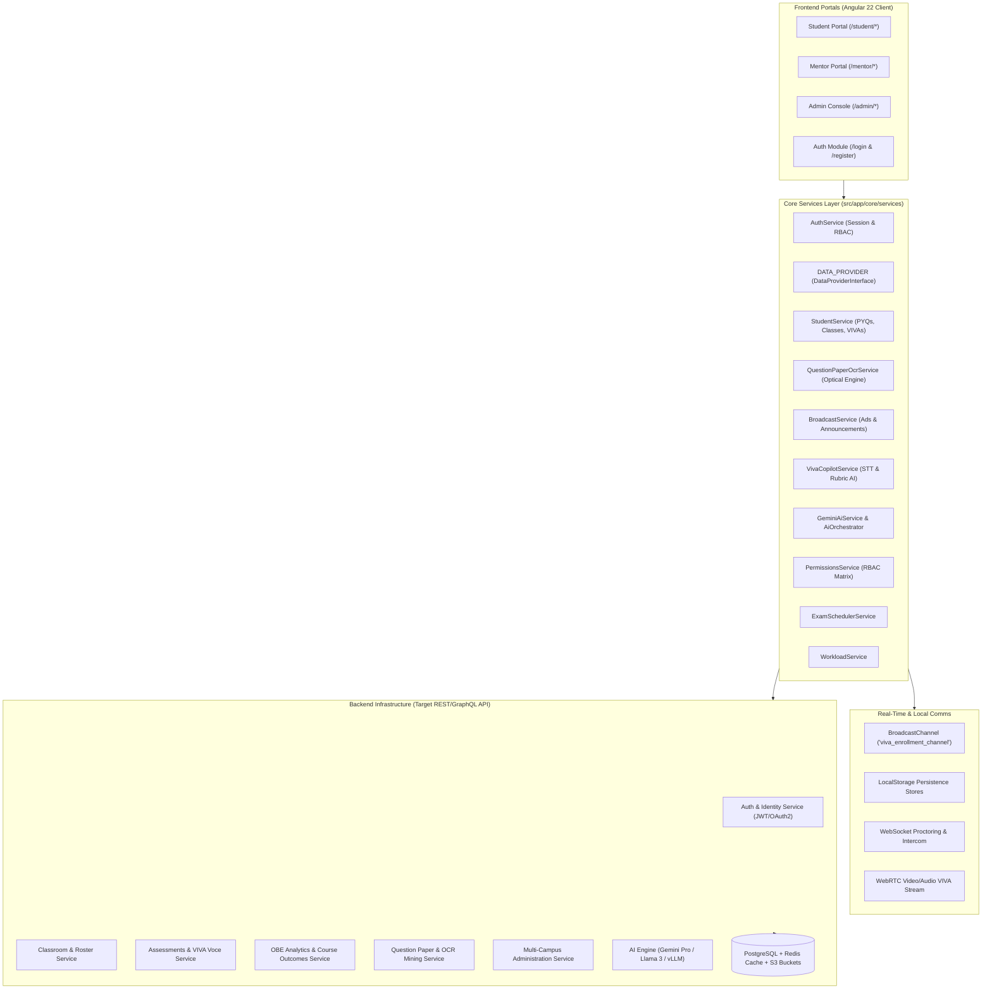
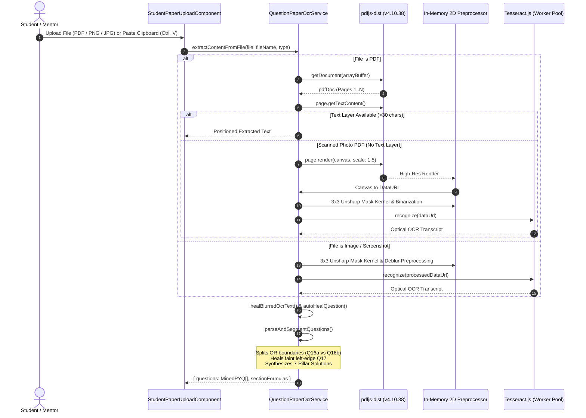

# ScholarX Platform: Complete Backend Connections & Architecture Specification

> **Document Version**: 2.5.0  
> **Target Framework**: Angular 22 (Standalone Signals) $\longleftrightarrow$ REST / WebSocket / WebRTC Backend Services  
> **Status**: Comprehensive Production-Ready Integration Guide  

---

## 1. System Architecture & High-Level Topology

ScholarX is organized into three segregated portals: **Student**, **Mentor**, and **Admin**. All portals communicate through unified core service layers, API tokens, real-time message buses, and persistent stores.



---

## 2. Authentication & Identity Backend Connections

* **Service File**: [`src/app/core/services/auth.service.ts`](file:///c:/Users/sahil/Desktop/mentor-frontend/src/app/core/services/auth.service.ts)
* **Models File**: [`src/app/core/models/auth.model.ts`](file:///c:/Users/sahil/Desktop/mentor-frontend/src/app/core/models/auth.model.ts)
* **Guards File**: [`src/app/core/guards/auth.guard.ts`](file:///c:/Users/sahil/Desktop/mentor-frontend/src/app/core/guards/auth.guard.ts)
* **Local Storage Keys**:
  * `scholarx_auth_current_user`: Active authenticated session object (`AuthUser`)
  * `scholarx_auth_users_database`: Seeded and registered user accounts

### 2.1 Endpoint Contract: Login
* **Method**: `POST`
* **Route**: `/api/v1/auth/login`
* **Calling Component**: [`LoginComponent`](file:///c:/Users/sahil/Desktop/mentor-frontend/src/app/features/auth/login/login.ts) via `authService.login(credentials)`
* **Request Payload (`LoginCredentials`)**:
```json
{
  "loginId": "student@apex.edu",
  "password": "student123",
  "role": "STUDENT"
}
```
* **Success Response (`200 OK`)**:
```json
{
  "success": true,
  "user": {
    "id": "usr-student-001",
    "name": "Rahul Sharma",
    "email": "student@apex.edu",
    "role": "STUDENT",
    "avatarUrl": "https://api.dicebear.com/7.x/bottts/svg?seed=Rahul",
    "institution": "Apex Institute of Technology",
    "department": "Computer Science & Engineering",
    "degreeProgram": "B.Tech Computer Science & AI",
    "rollNumber": "20230121",
    "yearSemester": "Year 3 / Sem 6",
    "createdAt": "2026-01-10"
  },
  "redirectUrl": "/student/dashboard"
}
```
* **Failure Responses**:
  * `400 Bad Request`: `{"success": false, "error": "Please enter Login ID and password."}`
  * `403 Forbidden`: `{"success": false, "error": "This account is registered as a MENTOR, but you logged in under the STUDENT portal."}`
  * `401 Unauthorized`: `{"success": false, "error": "Incorrect password. Please verify and try again."}`

### 2.2 Endpoint Contract: Student Registration
* **Method**: `POST`
* **Route**: `/api/v1/auth/register/student`
* **Calling Component**: [`RegisterComponent`](file:///c:/Users/sahil/Desktop/mentor-frontend/src/app/features/auth/register/register.ts) via `authService.registerStudent(data)`
* **Request Payload (`StudentRegistrationData`)**:
```json
{
  "fullName": "Aarav Patel",
  "email": "aarav.p@apex.edu",
  "rollNumber": "20239999",
  "collegeName": "Apex Institute of Technology",
  "degreeProgram": "B.Tech Computer Science & AI",
  "department": "Computer Science & Engineering",
  "yearSemester": "Year 3 / Sem 6",
  "password": "studentpass123",
  "confirmPassword": "studentpass123"
}
```
* **Success Response (`201 Created`)**:
```json
{
  "success": true,
  "user": {
    "id": "usr-student-1727142000000",
    "name": "Aarav Patel",
    "email": "aarav.p@apex.edu",
    "role": "STUDENT",
    "rollNumber": "20239999",
    "institution": "Apex Institute of Technology",
    "department": "Computer Science & Engineering",
    "degreeProgram": "B.Tech Computer Science & AI",
    "yearSemester": "Year 3 / Sem 6",
    "createdAt": "2026-09-24"
  },
  "redirectUrl": "/student/dashboard"
}
```

### 2.3 Endpoint Contract: Mentor / Faculty Registration
* **Method**: `POST`
* **Route**: `/api/v1/auth/register/mentor`
* **Calling Component**: [`RegisterComponent`](file:///c:/Users/sahil/Desktop/mentor-frontend/src/app/features/auth/register/register.ts) via `authService.registerMentor(data)`
* **Request Payload (`MentorRegistrationData`)**:
```json
{
  "academicTitle": "Prof.",
  "fullName": "Prof. Aris Thorne",
  "email": "aris.t@apex.edu",
  "facultyId": "SX-M401",
  "collegeName": "Apex Institute of Technology",
  "department": "Computer Science & AI",
  "designation": "Senior Professor & Viva Mentor",
  "teachingSpecialization": "Distributed Systems, Microcontrollers & 8051, Operating Systems",
  "isVivaExaminerAuthorized": true,
  "password": "mentor123",
  "confirmPassword": "mentor123"
}
```
* **Success Response (`201 Created`)**:
```json
{
  "success": true,
  "user": {
    "id": "usr-mentor-1727142000000",
    "name": "Prof. Aris Thorne",
    "email": "aris.t@apex.edu",
    "role": "MENTOR",
    "facultyId": "SX-M401",
    "academicTitle": "Prof.",
    "institution": "Apex Institute of Technology",
    "department": "Computer Science & AI",
    "designation": "Senior Professor & Viva Mentor",
    "teachingSpecialization": ["Distributed Systems", "Microcontrollers & 8051", "Operating Systems"],
    "isVivaExaminerAuthorized": true,
    "createdAt": "2026-09-24"
  },
  "redirectUrl": "/mentor/dashboard"
}
```

### 2.4 Private Administrator Access (No Public Registration)
* **Master Email**: `admin@scholarx.org`
* **Master Password**: `AdminMaster#2026`
* **Access Scope**: Governs multi-campus institutions, proctoring security policies, RBAC privilege matrix, and system uptime.
* **Security Guard Enforcement**:
  * Unauthenticated requests to `/admin/*` $\to$ Redirects to `/login?returnUrl=/admin/*`.
  * Authenticated Student attempting to access `/admin/*` $\to$ Intercepted by `roleGuard(['ADMIN'])`, redirected to `/student/dashboard`.
  * Authenticated Mentor attempting to access `/admin/*` $\to$ Intercepted by `roleGuard(['ADMIN'])`, redirected to `/mentor/dashboard`.

---

## 3. Classroom & Roster Backend Connections

* **Service File**: [`src/app/core/api/data-provider.interface.ts`](file:///c:/Users/sahil/Desktop/mentor-frontend/src/app/core/api/data-provider.interface.ts) & [`src/app/core/api/mock-data-provider.ts`](file:///c:/Users/sahil/Desktop/mentor-frontend/src/app/core/api/mock-data-provider.ts)
* **Student Interface**: [`src/app/core/services/student.service.ts`](file:///c:/Users/sahil/Desktop/mentor-frontend/src/app/core/services/student.service.ts)

### 3.1 Classroom Data Operations
| Function | HTTP Method & Route | Caller Component | Description |
| :--- | :--- | :--- | :--- |
| `getMentorClasses()` | `GET /api/v1/classes` | [`ClassesListComponent`](file:///c:/Users/sahil/Desktop/mentor-frontend/src/app/features/mentor/classes/classes-list/classes-list.ts) | Fetches list of mentor classrooms with enrolled counts |
| `getClassById(classId)` | `GET /api/v1/classes/:classId` | [`ClassDetailsComponent`](file:///c:/Users/sahil/Desktop/mentor-frontend/src/app/features/mentor/classes/class-details/class-details.ts) | Fetches classroom metadata, join code, and syllabus |
| `createClass(dto)` | `POST /api/v1/classes` | [`ClassesListComponent`](file:///c:/Users/sahil/Desktop/mentor-frontend/src/app/features/mentor/classes/classes-list/classes-list.ts) | Creates a new subject classroom with unique join code |
| `getClassStudents(classId)`| `GET /api/v1/classes/:classId/students` | [`ClassDetailsComponent`](file:///c:/Users/sahil/Desktop/mentor-frontend/src/app/features/mentor/classes/class-details/class-details.ts) | Returns students roster, attendance rate, and VIVA readiness |

### 3.2 Enrollment Requests & Peer Channel Sync
* **`getEnrollmentRequests(classId?)`**: `GET /api/v1/classes/:classId/enrollment-requests`
* **`approveEnrollment(requestId)`**: `POST /api/v1/enrollment-requests/:requestId/approve`
  * Emits event over `BroadcastChannel('viva_enrollment_channel')`:
    ```json
    { "type": "ENROLLMENT_APPROVED", "requestId": "req-101", "studentId": "std-20230121", "classId": "cls-cs601" }
    ```
* **`rejectEnrollment(requestId, reason)`**: `POST /api/v1/enrollment-requests/:requestId/reject`
* **`updateStudentStatus(classId, studentId, status, reason)`**: `PUT /api/v1/classes/:classId/students/:studentId/status`

### 3.3 Classroom Security Policies & Proctoring Invariants
* **`updateClassSecurityPolicy(classId, policy)`**: `PUT /api/v1/classes/:classId/security-policy`
  * Updates live proctoring invariants:
  ```json
  {
    "strictWindowLockout": true,
    "maxTabSwitchesAllowed": 2,
    "requireDualCamera": false,
    "blockClipboardPaste": true,
    "requireMicrophoneContinuous": true,
    "noiseThresholdDb": 45,
    "faceOrientationToleranceDegrees": 25,
    "aiAudioTranscribeActive": true
  }
  ```
* **`getTerminatedStudents(classId)`**: `GET /api/v1/classes/:classId/terminated-students`
* **`readmitTerminatedStudent(classId, studentId)`**: `POST /api/v1/classes/:classId/students/:studentId/readmit`
* **`logClassProctorIncident(incident)`**: `POST /api/v1/classes/:classId/proctor-incidents`

---

## 4. Assessment, Oral VIVA & Question Paper Backend Connections

* **Models File**: [`src/app/core/models/index.ts`](file:///c:/Users/sahil/Desktop/mentor-frontend/src/app/core/models/index.ts)
* **Caller Component**: [`AssessmentsListComponent`](file:///c:/Users/sahil/Desktop/mentor-frontend/src/app/features/mentor/assessments/assessments-list/assessments-list.ts)
* **Student Runner**: [`StudentPracticeComponent`](file:///c:/Users/sahil/Desktop/mentor-frontend/src/app/features/student/practice/student-practice.ts)

### 4.1 Modality Separation: `ORAL_VIVA` vs `QUESTION_PAPER`
The backend categorizes assessments via the `assessmentType` discriminator field:

```typescript
export interface Assessment {
  id: string;
  classId: string;
  title: string;
  type: 'AI_VIVA' | 'MCQ' | 'MINED_PYQ' | 'HYBRID';
  assessmentType?: 'ORAL_VIVA' | 'QUESTION_PAPER';
  durationMinutes: number;
  maxMarks: number;
  bloomCriteria: Record<BloomLevel, number>;
  questions: AssessmentQuestion[];
  status: 'DRAFT' | 'PUBLISHED' | 'SCHEDULED' | 'ARCHIVED';
  // Question Paper Assessment specific metadata
  topicFocus?: string;
  scheduledVenue?: string;
  scheduledReleaseTime?: string;
  scheduledEndTime?: string;
  solutionFormat?: 'WITH_SOLUTIONS' | 'QUESTIONS_ONLY';
  acceptanceSummary?: {
    totalEnrolled: number;
    acceptedCount: number;
    pendingCount: number;
    deniedCount: number;
  };
  studentRosterStatus?: AssignmentStudentAcceptance[];
}
```

### 4.2 Endpoint Contract: Assessments Listing
* **Method**: `GET`
* **Route**: `/api/v1/assessments?classId=:classId&assessmentType=:type`
* **Response Payload (`200 OK`)**:
```json
[
  {
    "id": "asm-101",
    "assessmentType": "ORAL_VIVA",
    "title": "Mid-Term Oral VIVA: Raft Consensus & CAP Theorem",
    "classId": "cls-cs601",
    "type": "AI_VIVA",
    "durationMinutes": 30,
    "maxMarks": 25,
    "status": "PUBLISHED"
  },
  {
    "id": "asm-102",
    "assessmentType": "QUESTION_PAPER",
    "title": "Practice Paper #1: Raft Consensus & CAP Invariants Drill",
    "classId": "cls-cs601",
    "type": "MINED_PYQ",
    "durationMinutes": 45,
    "maxMarks": 30,
    "status": "PUBLISHED",
    "scheduledVenue": "Self-Practice & OCR Archive",
    "solutionFormat": "WITH_SOLUTIONS",
    "acceptanceSummary": {
      "totalEnrolled": 12,
      "acceptedCount": 8,
      "pendingCount": 3,
      "deniedCount": 1
    }
  }
]
```

### 4.3 Student Acceptance & Drill Submission
* **`acceptMentorPracticePaper(paperId, studentId)`**:
  * **Route**: `POST /api/v1/practice-papers/:paperId/accept`
  * **Payload**: `{"studentId": "std-20230121", "acceptedAt": "2026-09-24T01:00:00Z"}`
  * Unlocks assessment question runner, changes status badge to `✓ ACCEPTED BY YOU`.
* **`recordStudentPracticeAttempt(paperId, attemptData)`**:
  * **Route**: `POST /api/v1/practice-papers/:paperId/submit-attempt`
  * Saves student draft answers, question-by-question marks breakdown, and assigns `✓ Attempt Submitted` status.

---

## 5. Optical OCR & Question Paper Ingestion Backend

* **Service File**: [`src/app/core/services/question-paper-ocr.service.ts`](file:///c:/Users/sahil/Desktop/mentor-frontend/src/app/core/services/question-paper-ocr.service.ts)
* **Caller Component**: [`StudentPaperUploadComponent`](file:///c:/Users/sahil/Desktop/mentor-frontend/src/app/features/student/paper-upload/student-paper-upload.ts)

### 5.1 Pipeline Steps & Technologies


### 5.2 Image Preprocessing Convolution Kernel
The unsharp mask kernel sharpens faded photocopied exam text prior to Tesseract character recognition:
$$\text{Output}(x,y) = 5 \cdot I(x,y) - \big(I(x-1,y) + I(x+1,y) + I(x,y-1) + I(x,y+1)\big)$$
Followed by dynamic threshold binarization:
$$I_{\text{binary}}(x,y) = \begin{cases} 0 & \text{if } I_{\text{gray}}(x,y) < \text{threshold} \times 0.95 \quad (\text{darken ink}) \\ 255 & \text{otherwise} \end{cases}$$

### 5.3 7-Pillar Model Solutions Structure
Each parsed question is synthesized into an Indian academic standard marking breakdown:
1. **Definition & Context**: Core concept in academic terminology
2. **Intuitive Real-World Analogy**: High-yield parallel for rapid memorization
3. **Step-by-Step Derivation**: Mathematical proof or algorithm invariant
4. **Architecture Diagram**: Clean ASCII/Unicode system block schematic
5. **Examiner Rubric Criteria**: Exact breakdown of marks allocation (e.g. 2M diagram, 4M derivation, 4M working)
6. **Common Traps & Pitfalls**: Frequent mistakes that cause mark deduction
7. **Cross-University Frequency**: Recurrence history across AKTU, RTU, VTU, Mumbai University

---

## 6. AI Viva Voce & Speech Synthesis Backend

* **Service File**: [`src/app/core/services/viva-copilot.service.ts`](file:///c:/Users/sahil/Desktop/mentor-frontend/src/app/core/services/viva-copilot.service.ts)
* **Caller Component**: [`StudentVivaComponent`](file:///c:/Users/sahil/Desktop/mentor-frontend/src/app/features/student/viva/student-viva.ts) & [`VivaCopilotComponent`](file:///c:/Users/sahil/Desktop/mentor-frontend/src/app/features/mentor/viva-copilot/viva-copilot.ts)

### 6.1 Audio/Speech Processing Connections
* **Web Speech API**:
  * `webkitSpeechRecognition` / `SpeechRecognition`: Transcribes student spoken defense live.
  * `SpeechSynthesisUtterance`: Generates natural spoken viva questions from the AI Examiner avatar.
* **Telemetry Data Contract (`VivaQuestionEvaluationItem`)**:
```json
{
  "questionId": "vq-101",
  "questionText": "Explain the role of raft leader election and randomized election timeouts.",
  "studentSpokenTranscript": "In Raft consensus, leader election uses randomized timers between 150ms and 300ms to avoid split vote split-brain scenarios...",
  "marksAwarded": 9.5,
  "maxMarks": 10.0,
  "rubricScores": {
    "conceptualClarity": 9,
    "technicalVocabulary": 10,
    "confidenceAndFluency": 9,
    "edgeCaseHandling": 10
  },
  "examinerFeedback": "Accurately identified election timeout randomization and split-brain mitigation.",
  "integrityViolations": []
}
```

---

## 7. Broadcasts, Campaigns & Announcements Backend

* **Service File**: [`src/app/core/services/broadcast.service.ts`](file:///c:/Users/sahil/Desktop/mentor-frontend/src/app/core/services/broadcast.service.ts)
* **Caller Component**: [`App`](file:///c:/Users/sahil/Desktop/mentor-frontend/src/app/app.ts)

### 7.1 Broadcast Data Endpoints
| Function | Method & Route | Payload / Return | Description |
| :--- | :--- | :--- | :--- |
| `getBroadcastItems()` | `GET /api/v1/broadcasts` | `BroadcastItem[]` | Fetches active campaigns & hackathons |
| `submitStudentRegistration(data)` | `POST /api/v1/broadcasts/:id/register` | Student routing metadata | Directs student application to their assigned faculty mentor |
| `getGlobalNotice()` | `GET /api/v1/broadcasts/notice` | `GlobalNoticeItem` | System-wide emergency or academic banner notice |
| `dismissGlobalNotice()` | `POST /api/v1/broadcasts/notice/dismiss` | `{ success: true }` | Dismisses persistent notification banner |

---

## 8. Admin Operations, RBAC & Multi-Campus Governance

* **Service File**: [`src/app/core/services/permissions.service.ts`](file:///c:/Users/sahil/Desktop/mentor-frontend/src/app/core/services/permissions.service.ts)
* **Caller Components**: [`UserDirectoryComponent`](file:///c:/Users/sahil/Desktop/mentor-frontend/src/app/features/admin/users/user-directory/user-directory.ts), [`InstitutionsListComponent`](file:///c:/Users/sahil/Desktop/mentor-frontend/src/app/features/admin/institutions/institutions-list/institutions-list.ts), [`AdminPermissionsComponent`](file:///c:/Users/sahil/Desktop/mentor-frontend/src/app/features/admin/permissions/admin-permissions.ts)

### 8.1 Administrative Operations
* **`getAdminKpis()`**: `GET /api/v1/admin/kpis`
  * Returns: `{"totalStudents": 1420, "totalFaculty": 84, "activeInstitutions": 4, "activeVivas": 18}`
* **`getAdminUsers(role?)`**: `GET /api/v1/admin/users?role=:role`
  * Returns user directory filtered by role (`ALL`, `STUDENT`, `MENTOR`, `INSTITUTION_ADMIN`, `SYSTEM_ADMIN`).
* **`toggleUserStatus(userId, status)`**: `PUT /api/v1/admin/users/:userId/status`
* **`getInstitutions()`**: `GET /api/v1/admin/institutions`
  * Returns multi-campus institution profiles (`Apex Institute of Technology`, `Horizon Engineering College`, `Metro Polytechnic Campus`, `Pacific School of Computing`).
* **`onboardInstitution(dto)`**: `POST /api/v1/admin/institutions`
* **`toggleRoleCapability(roleKey, capabilityKey)`**: `PATCH /api/v1/admin/roles/:roleKey/capabilities`
  * Updates granular permissions (e.g. `MANAGE_VIVA`, `EDIT_SECURITY_POLICY`, `OVERRIDE_PROCTOR`).

---

## 9. LocalStorage Persistence Schema Reference

| Storage Key | Data Type | Owner Service | Purpose |
| :--- | :--- | :--- | :--- |
| `scholarx_auth_current_user` | `AuthUser` | `AuthService` | Persists logged-in user session across reloads |
| `scholarx_auth_users_database` | `StoredAccount[]` | `AuthService` | Mock user accounts database with password hashes |
| `viva_student_joined_classes` | `StudentJoinedClass[]` | `StudentService` | Classrooms student has joined with attendance |
| `viva_enrollment_requests_roster` | `EnrollmentRequest[]`| `StudentService` | Queue of pending enrollment applications |
| `scholarx_mentor_practice_papers` | `MentorPracticePaper[]`| `StudentService` | Practice papers published from Question Paper OCR |
| `viva_class_isolated_messages` | `ChatMessage[]` | `StudentService` | Real-time classroom chat history |
| `viva_live_notifications_feed` | `StudentNotificationItem[]` | `StudentService` | Activity notifications stream |
| `viva_theme_preference` | `StudentThemePreference` | `StudentService` | Dark mode, color accent, and font scale |

---

## 10. Target Production REST API Endpoints Summary

```
========================================================================================
METHOD    ENDPOINT                                       AUTH REQUIRED    ROLE
========================================================================================
POST      /api/v1/auth/login                             No               Public
POST      /api/v1/auth/register/student                  No               Public
POST      /api/v1/auth/register/mentor                   No               Public
POST      /api/v1/auth/logout                            Yes              Any
GET       /api/v1/auth/me                                Yes              Any

GET       /api/v1/classes                                Yes              MENTOR, ADMIN
POST      /api/v1/classes                                Yes              MENTOR, ADMIN
GET       /api/v1/classes/:id                            Yes              STUDENT, MENTOR, ADMIN
GET       /api/v1/classes/:id/students                   Yes              MENTOR, ADMIN
GET       /api/v1/classes/:id/enrollment-requests        Yes              MENTOR, ADMIN
POST      /api/v1/classes/:id/join                       Yes              STUDENT
POST      /api/v1/enrollment-requests/:id/approve        Yes              MENTOR, ADMIN
POST      /api/v1/enrollment-requests/:id/reject         Yes              MENTOR, ADMIN
PUT       /api/v1/classes/:id/security-policy            Yes              MENTOR, ADMIN
GET       /api/v1/classes/:id/terminated-students        Yes              MENTOR, ADMIN
POST      /api/v1/classes/:id/students/:sid/readmit      Yes              MENTOR, ADMIN
POST      /api/v1/classes/:id/proctor-incidents          Yes              STUDENT, MENTOR

GET       /api/v1/assessments                            Yes              STUDENT, MENTOR, ADMIN
POST      /api/v1/assessments                            Yes              MENTOR, ADMIN
GET       /api/v1/assessments/:id                        Yes              STUDENT, MENTOR, ADMIN
POST      /api/v1/assessments/:id/publish                Yes              MENTOR, ADMIN
POST      /api/v1/assessments/generate-ai                Yes              MENTOR, ADMIN

POST      /api/v1/practice-papers                        Yes              STUDENT, MENTOR
GET       /api/v1/practice-papers                        Yes              STUDENT, MENTOR
POST      /api/v1/practice-papers/:id/accept             Yes              STUDENT
POST      /api/v1/practice-papers/:id/submit-attempt     Yes              STUDENT

GET       /api/v1/analytics/classes/:id                  Yes              MENTOR, ADMIN
GET       /api/v1/analytics/classes/:id/outcomes         Yes              MENTOR, ADMIN
POST      /api/v1/analytics/classes/:id/outcomes         Yes              MENTOR, ADMIN
GET       /api/v1/analytics/classes/:id/report.pdf       Yes              MENTOR, ADMIN

GET       /api/v1/proctoring/sessions/:assessmentId      Yes              MENTOR, ADMIN
POST      /api/v1/proctoring/intercom                    Yes              MENTOR, ADMIN

GET       /api/v1/broadcasts                             No               Public
POST      /api/v1/broadcasts/:id/register                Yes              STUDENT
GET       /api/v1/broadcasts/notice                      No               Public

GET       /api/v1/chat/channels                          Yes              STUDENT, MENTOR
GET       /api/v1/chat/channels/:id/messages             Yes              STUDENT, MENTOR
POST      /api/v1/chat/channels/:id/messages             Yes              STUDENT, MENTOR

GET       /api/v1/admin/kpis                             Yes              ADMIN
GET       /api/v1/admin/users                            Yes              ADMIN
PUT       /api/v1/admin/users/:id/status                 Yes              ADMIN
GET       /api/v1/admin/institutions                     Yes              ADMIN
POST      /api/v1/admin/institutions                     Yes              ADMIN
PATCH     /api/v1/admin/roles/:roleKey/capabilities      Yes              ADMIN
========================================================================================
```
