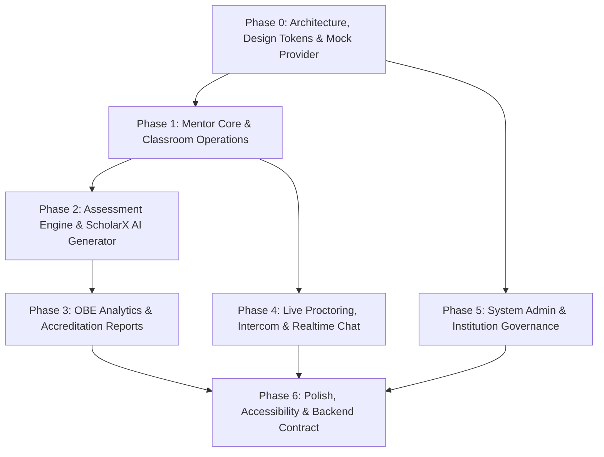

# ScholarX Mentor & Admin Web Frontend — Phased Roadmap & Documentation Plan

Divide the 1839-line PRD for the ScholarX (formerly VIVA-AI) Mentor and Admin Web Frontend into clear, modular execution phases. Prepare comprehensive documentation for each phase so that development can proceed iteratively and simply with a realistic mock API layer, while other teammates work on the FastAPI backend and student frontend.

---

## User Review Required

> [!IMPORTANT]
> **No Backend Code Execution**: In strict accordance with your instruction, no backend implementation or full-stack databases (FastAPI, MongoDB, Supabase, JWT servers) will be built. The frontend will strictly employ a **Mock Data Provider Layer** behind feature services, ensuring zero rework when swapping to the real Platform API later.

> [!IMPORTANT]
> **Documentation-First Phase**: Currently, we are preparing the architecture and specifications documentation files. No Angular application code will be generated until you review and approve these phase documents.

> [!TIP]
> **Proposed Color Palette for ScholarX**:
> We have designed an enterprise-grade, modern academic color palette for ScholarX:
> - **Primary Brand**: *Deep Indigo* (`#4F46E5` / `#4338CA`) — communicates academic authority and advanced AI intelligence.
> - **Accent / AI Core**: *Electric Sky* (`#0EA5E9`) and *Nebula Purple* (`#8B5CF6`) — used for AI assessment generation, active indicators, and Bloom taxonomy tags.
> - **Backgrounds & Surfaces**: Clean Slate palette (`#F8FAFC` base, `#FFFFFF` cards, `#F1F5F9` borders, `#0F172A` headings).
> - **Semantic States**: Emerald (`#10B981` / Active), Amber (`#F59E0B` / Pending / Warning), Rose (`#EF4444` / Critical Alert / Reject / Suspend).
> *You can approve this palette or provide custom color codes at any time.*

---

## Proposed Phase Breakdown

We propose breaking down ScholarX into **6 Logical Phases**, each self-contained and documented with clear acceptance criteria, UI/UX specs, data models, and mock contracts:

### Phase Details

1. **Phase 0: Architecture, Design System & Mock Service Bedrock**
   - Angular 18 Standalone Architecture (Signals, OnPush, `inject()`).
   - ScholarX Design System: Typography, elevation, border-radii, color tokens, and atomic components (Button, Badge, Modal, Card, Table, EmptyState, SkeletonLoader).
   - Core abstraction: `ApiProviderInterface` with `MockDataProvider` implementation and synthetic latency/error injectors.
   - Layout shells: Mentor Shell & Admin Shell with responsive collapsible sidebars, topbar navigation, and user menu.

2. **Phase 1: Mentor Core & Classroom Operations**
   - Mentor Dashboard: Key summary metrics (Active Classes, Pending Approvals, Upcoming Tests, Enrolled Students), quick actions, and recent activity feed.
   - Classroom Management: Class listing, Class creation form (join code generation simulated via provider), tabbed Class Details workspace.
   - Student Roster & Enrollment Approval Queue: Approve/Reject workflow with rejection note dialogs, student profile view.
   - Student Lifecycle: Suspend/Terminate confirmation modals and status transitions (`ACTIVE`, `PENDING`, `SUSPENDED`, `TERMINATED`).

3. **Phase 2: Assessment Management & ScholarX AI Test Generator**
   - Assessment Lifecycle: List and filters (`DRAFT`, `PUBLISHED`, `ACTIVE`, `CLOSED`, `ARCHIVED`), metadata viewer, and manual question editor.
   - **ScholarX AI Generator**:
     - Configuration form: Subject, Topic, Difficulty, Question count, Format, Target CO/PO, Bloom's Taxonomy level.
     - Interactive generation experience: Skeleton loading states, question review cards.
     - Single question regeneration with custom instructions while preserving CO/PO/Bloom metadata.
     - Publishing flow with pre-publish checklist and confirmation modal.
   - Assessment History and submission statistics.

4. **Phase 3: OBE Analytics, Outcomes Configuration & Accreditation Reports**
   - CO/PO Configuration Matrix: Course Outcomes (CO1-CO6) weightage setup, Program Outcomes (PO1-PO4) mapping, threshold validation.
   - Class Analytics: Average/High/Low scores, pass rate, completion rate, CO attainment progress meters, failure hotspot identification.
   - AI Pedagogical Recommendations: Contextual guidance cards based on low-performing topics.
   - Accreditation Reports: NBA/NAAC outcome compliance summaries and Class PDF report export UI (downloading, ready, retry states).

5. **Phase 4: Live Proctoring, Intercom & Realtime Communication**
   - Live Proctoring Grid: Candidate video stream cards, connection health badges, candidate search, and severity filters (`INFO`, `WARNING`, `CRITICAL`).
   - Proctoring Alerts: Tab switch, face absent, camera/mic disconnect, suspicious activity tracking.
   - Candidate Focus Inspector & Intercom: Send real-time audio/text warnings directly to a student during an active VIVA session.
   - Mentor Notification Center & Classroom Chat Channels.

6. **Phase 5: System Admin & Multi-Institution Governance**
   - Admin Global Dashboard: Platform-wide KPIs (total students, mentors, institutions, active VIVAs, system alerts).
   - User Directory: Tabbed table (`All`, `Students`, `Mentors`, `Admins`) with search, filter, status toggles, and edit actions.
   - Institution Management: Institution profiles, code mapping, active class oversight.
   - System Audit Reports & Platform Configuration.

7. **Phase 6: Backend Integration Contract & Drop-in Switch Blueprint**
   - Complete FastAPI Endpoint Specification mapping 100% of frontend services to future REST endpoints.
   - TypeScript Interfaces and DTO schema definitions.
   - Zero-rework transition guide: Swapping `provide(DATA_PROVIDER, { useClass: MockDataProvider })` to `PlatformApiDataProvider`.

---

## Open Questions

> [!NOTE]
> 1. **Color Palette Preference**: Do you want to adopt the proposed **Deep Indigo & Electric Sky** palette, or do you have specific brand HEX codes / college brand guidelines you want ScholarX to follow?
> 2. **Documentation Structure**: We will store all phase documents inside a `docs/` folder in the project root (`d:\mentor-frontend\docs\`). Is this location good for your team repository?
> 3. **AI Viva Specialization**: In Phase 4 (Proctoring/Intercom), does ScholarX also require a view for the mentor to watch the AI-driven VIVA bot asking questions to the student in real-time, or is traditional video + alert proctoring sufficient for now?

---

## Proposed Changes

We will create a structured documentation suite in `d:\mentor-frontend\docs\`:

### Documentation Suite

#### [NEW] [docs/README.md](file:///d:/mentor-frontend/docs/README.md)
- Master index, project mission for ScholarX, role definitions, architectural invariants, and high-level phase roadmap.

#### [NEW] [docs/phase-0-architecture-and-design-system.md](file:///d:/mentor-frontend/docs/phase-0-architecture-and-design-system.md)
- Angular 18 project architecture, folder structure, standalone signals pattern, ScholarX design system tokens, color palette specification, reusable UI component catalog, and Mock Provider abstraction.

#### [NEW] [docs/phase-1-mentor-core-and-classes.md](file:///d:/mentor-frontend/docs/phase-1-mentor-core-and-classes.md)
- Mentor Dashboard, Class CRUD, Student Roster, Enrollment Approval Queue, Suspend/Terminate workflows, UI states, and Mock data schemas.

#### [NEW] [docs/phase-2-assessments-and-ai-generator.md](file:///d:/mentor-frontend/docs/phase-2-assessments-and-ai-generator.md)
- Assessment Lifecycle, Question Editor, ScholarX AI Assessment Generator UX, Bloom's Taxonomy & CO/PO tags, single question regeneration, and draft/publish workflows.

#### [NEW] [docs/phase-3-obe-analytics-and-reports.md](file:///d:/mentor-frontend/docs/phase-3-obe-analytics-and-reports.md)
- CO/PO configuration matrix, Class Analytics dashboards, CO Attainment visualizers, AI pedagogical recommendations, and Accreditation PDF report export UI.

#### [NEW] [docs/phase-4-live-proctoring-and-communication.md](file:///d:/mentor-frontend/docs/phase-4-live-proctoring-and-communication.md)
- Live candidate monitoring grid, proctoring alert taxonomy (Tab switch, Face absent), Candidate inspector, Mentor Intercom messaging, Notification center, and Class Chat.

#### [NEW] [docs/phase-5-admin-portal.md](file:///d:/mentor-frontend/docs/phase-5-admin-portal.md)
- System Admin dashboard, User Directory management (Students, Mentors, Admins), Institution management, Platform audit logs, and settings.

#### [NEW] [docs/phase-6-backend-contract-and-mock-spec.md](file:///d:/mentor-frontend/docs/phase-6-backend-contract-and-mock-spec.md)
- Complete REST endpoint mapping table for the backend team (FastAPI), TypeScript DTO definitions, realistic mock data dataset specifications, and the zero-rework backend cutover strategy.

---

## Verification Plan

### Manual Verification
- Verify that every module from the 1839-line PRD is accounted for and categorized into the appropriate phase document.
- Verify that all business rules regarding frontend/backend decoupling (no database, no client-side authoritative scoring, no direct mock data in components) are preserved across all phase documents.
- Verify that document links, tables, and architectural diagrams are formatted cleanly in GitHub-flavored markdown.
