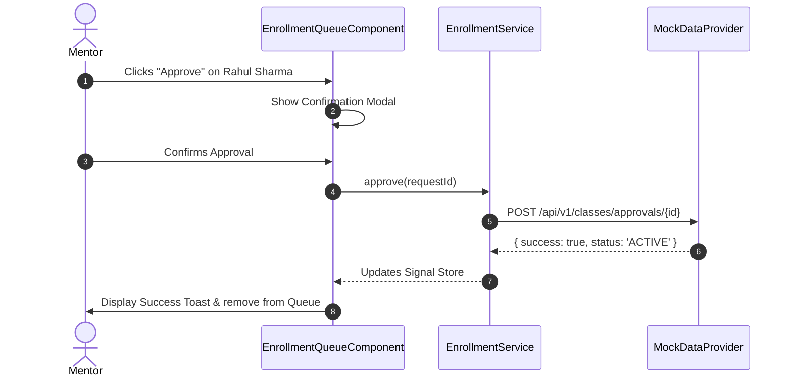

# ScholarX — Phase 1: Mentor Core & Classroom Operations

**Target Scope:** Faculty/Mentor Dashboard, Classroom CRUD, Tabbed Class Workspace, Student Roster, and Enrollment Approval/Rejection Queue.  
**Deliverable:** Complete operational classroom experience operating against realistic in-memory academic mock data.  
**Primary Routes:** `/mentor/dashboard`, `/mentor/classes`, `/mentor/classes/create`, `/mentor/classes/:classId`  

---

## 1. Feature Specifications

### 1.1 Mentor Dashboard (`/mentor/dashboard`)

The central command hub for faculty upon authenticating into ScholarX.

#### Visual Hierarchy & Layout Wireframe

```text
┌──────────────────────────────────────────────────────────────────────────────────┐
│  Welcome back, Prof. Aris Thorne                Department of Computer Science   │
│  Apex Institute of Technology                   Term: Fall 2026                  │
├──────────────────────────────────────────────────────────────────────────────────┤
│  ┌─────────────────┐ ┌─────────────────┐ ┌─────────────────┐ ┌─────────────────┐  │
│  │ ACTIVE CLASSES  │ │ PENDING ENROLL  │ │ UPCOMING TESTS  │ │ TOTAL STUDENTS  │  │
│  │       05        │ │       07        │ │       03        │ │       186       │  │
│  │ +1 new this term│ │ Action required │ │ Next: Tomorrow  │ │ 94% attendance  │  │
│  └─────────────────┘ └─────────────────┘ └─────────────────┘ └─────────────────┘  │
├────────────────────────────────────────┬─────────────────────────────────────────┤
│ ACTIVE CLASSES                         │ PENDING ENROLLMENT REQUESTS             │
│ ┌────────────────────────────────────┐ │ ┌─────────────────────────────────────┐ │
│ │ CS401 - Distributed Systems       │ │ │ Rahul Sharma  (ID: 20230121)         │ │
│ │ 42 Students • 2 Pending • Exam Fri │ │ │ CS401 • 2h ago  [Reject] [Approve]  │ │
│ ├────────────────────────────────────┤ │ ├─────────────────────────────────────┤ │
│ │ CS302 - Computer Networks          │ │ │ Ananya Sen    (ID: 20230145)         │ │
│ │ 58 Students • 3 Pending • Next wk  │ │ │ CS302 • 5h ago  [Reject] [Approve]  │ │
│ └────────────────────────────────────┘ │ └─────────────────────────────────────┘ │
├────────────────────────────────────────┴─────────────────────────────────────────┤
│ RECENT ACTIVITY STREAM                                                           │
│ • Rahul Sharma submitted enrollment request for CS401 (2 hours ago)              │
│ • Assessment "Midterm Viva: Congestion Control" scheduled for Oct 12             │
│ • System audit: 48 Viva results compiled and published                           │
└──────────────────────────────────────────────────────────────────────────────────┘
```

---

### 1.2 Classroom Management (`/mentor/classes`)

#### 1.2.1 Class Listing View
Displays grid/table cards of all classes mentored by the authenticated faculty member.

- **Attributes per Card**:
  - Class Name & Subject Code (e.g., `CS302 - Computer Networks`)
  - Department & Semester (`Computer Science • Sem 5 • 2026-27`)
  - Unique Student Join Code (e.g., `NET-8924` with quick copy-to-clipboard button)
  - Student Count & Pending Enrollment Badge (`58 Enrolled • 3 Pending`)
  - Status Pill (`ACTIVE`, `ARCHIVED`)
  - Primary Action Button: `Enter Workspace →`

#### 1.2.2 Create Class Flow (`/mentor/classes/create`)
A modal dialog or dedicated page containing:
- **Form Fields**:
  - Class Name (required, min 3 chars)
  - Subject Title & Subject Code (e.g., `Distributed Computing`, `CS501`)
  - Department Dropdown (pre-populated with faculty's department)
  - Semester (1 to 8) & Academic Year (e.g., `2026-2027`)
  - Description / Syllabus Overview (optional rich text)
- **Architectural Rule**: The frontend **never generates the Join Code**. The form submission triggers `provider.createClass(dto)`, and the mock provider/backend returns the officially assigned Join Code.

---

### 1.3 Class Workspace (`/mentor/classes/:classId`)

A tabbed interface organizing all operations for a specific class:

```text
┌────────────────────────────────────────────────────────────────────────────────────────┐
│ CS401 — Distributed Systems (Code: DIST-4912)                    [Edit Class] [Archive] │
├───────────┬──────────┬──────────────┬─────────────┬───────────┬──────────────┬─────────┤
│ Overview  │ Students │ Enrollments  │ Assessments │ Analytics │ Conversation │ Settings│
├───────────┴──────────┴──────────────┴─────────────┴───────────┴──────────────┴─────────┤
│                                                                                        │
│ [Active Tab Content Renders Here]                                                      │
│                                                                                        │
└────────────────────────────────────────────────────────────────────────────────────────┘
```

---

### 1.4 Student Roster & Lifecycle Management

Located under `/mentor/classes/:classId/students`:

- **Data Table Columns**:
  1. Student Avatar & Full Name
  2. University Roll Number / Student ID
  3. Official Institutional Email
  4. Enrollment Timestamp
  5. Attendance / Completed Assessments Count
  6. Status Badge:
     - `ACTIVE` (Green)
     - `PENDING` (Amber)
     - `SUSPENDED` (Orange)
     - `TERMINATED` (Red)
  7. Actions Dropdown: `[View Profile]`, `[Suspend Access]`, `[Terminate Enrollment]`

#### 1.4.1 Suspend / Terminate Flow
- **Interaction**: Triggering "Suspend" or "Terminate" opens a confirmation modal requiring the mentor to select an administrative reason (e.g., "Academic Dishonesty", "Fee Clearance", "Voluntary Drop").
- **Decoupling Rule**: The component dispatches an event through `ClassService.updateStudentStatus()`. It does **not** directly mutate local arrays. The UI reacts to the updated stream returned by the service.

---

### 1.5 Enrollment Request Queue (`/mentor/classes/:classId/enrollment`)

When students use the class join code, their requests enter this review queue.

#### Approval & Rejection Flow



- **Rejection Dialog**: If the mentor selects `[Reject]`, an accessible modal requests an optional explanation note that will be dispatched to the student's notification feed.

---

## 2. TypeScript Domain Models

```typescript
// src/app/core/models/class.model.ts
export type StudentEnrollmentStatus = 'ACTIVE' | 'PENDING' | 'SUSPENDED' | 'TERMINATED';

export interface MentorClass {
  id: string;
  name: string;
  subjectCode: string;
  department: string;
  semester: number;
  academicYear: string;
  joinCode: string;
  enrolledCount: number;
  pendingRequestsCount: number;
  status: 'ACTIVE' | 'ARCHIVED';
  createdAt: string;
}

export interface StudentRosterItem {
  id: string;
  studentId: string;
  name: string;
  email: string;
  avatarUrl?: string;
  department: string;
  enrolledAt: string;
  status: StudentEnrollmentStatus;
  completedVivasCount: number;
}

export interface EnrollmentRequest {
  id: string;
  classId: string;
  className: string;
  studentId: string;
  studentName: string;
  studentEmail: string;
  requestedAt: string;
  academicNotes?: string;
}
```

---

## 3. UI States Matrix

| View | Loading State | Empty State | Error State |
| :--- | :--- | :--- | :--- |
| **Classes Grid** | 6-card shimmer skeleton | "No classes found. Create your first class to get started." + `[Create Class]` CTA button | "Failed to load classes" banner + `[Retry]` button |
| **Enrollment Queue** | 3-row shimmer table | "All caught up! No pending enrollment requests." | "Unable to process enrollment" toast with error code |
| **Student Roster** | Full table skeleton loader | "No students currently enrolled in this class." | Error alert with connection diagnostics |

---

## 4. Phase 1 Acceptance Criteria

- [ ] Mentor Dashboard renders all 4 summary KPI cards accurately from `MockDataProvider`.
- [ ] Classroom cards render join code with functional one-click copy button.
- [ ] Create Class form validates all required fields and updates the active class list upon simulated success.
- [ ] Tabbed Class workspace retains active tab state via query parameters (e.g., `?tab=students`).
- [ ] Enrollment Queue correctly handles Approve and Reject flows with confirmation modals.
- [ ] Student Roster supports search filtering by name and status dropdown filtering (`ACTIVE`, `SUSPENDED`, etc.).
