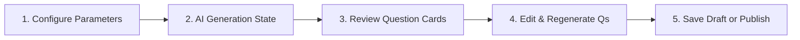

# ScholarX — Phase 2: Assessments & AI Test Generator

**Target Scope:** Assessment Management, Manual Question Authoring, ScholarX AI Assessment Generator Wizard, Question Regeneration with Prompt Injections, and Assessment Publishing Workflow.  
**Deliverable:** Full-lifecycle assessment creation and AI-driven authoring studio operating against the Mock Data Provider.  
**Primary Routes:** `/mentor/assessments`, `/mentor/assessments/:id`, `/mentor/ai-generator`  

---

## 1. Feature Specifications

### 1.1 Assessment Management Hub (`/mentor/assessments`)

Faculty can browse, search, and manage all formative and summative assessments across their assigned classrooms.

#### Filter & Status Taxonomy

```text
┌────────────────────────────────────────────────────────────────────────────────────────┐
│ Assessments Repository                                  [+ Manual Test] [✨ AI Generator]│
├────────────────────────────────────────────────────────────────────────────────────────┤
│ Status Filter: [All] [Draft (2)] [Published (3)] [Active (1)] [Closed (14)] [Archived]  │
│ Class Filter:  [All Classes ▾]     Search: [Search assessment by title...            ] │
├────────────────────────────────────────────────────────────────────────────────────────┤
│ Title                       Class       Questions  Marks  Duration  Status    Actions  │
├────────────────────────────────────────────────────────────────────────────────────────┤
│ Midterm Oral Viva           CS401       10 Qs      50 M   30 mins   ACTIVE    [Monitor]│
│ Congestion Control Drill    CS302       05 Qs      25 M   15 mins   DRAFT     [Edit]   │
│ Cloud Native Architecture   CS505       15 Qs      75 M   45 mins   PUBLISHED [View]   │
└────────────────────────────────────────────────────────────────────────────────────────┘
```

---

### 1.2 ScholarX AI Assessment Generator (`/mentor/ai-generator`)

The flagship authoring tool of ScholarX. Empowers faculty to generate pedagogy-aligned viva examinations and question sets in seconds using structured academic parameters.

#### 1.2.1 The 5-Step Generator Lifecycle



#### 1.2.2 Configuration Form Parameters

Faculty configure the AI generator using strict academic taxonomies:

| Field | Input Control | Values / Constraints |
| :--- | :--- | :--- |
| **Classroom** | Single Select | Pre-populated from faculty's active classrooms |
| **Subject & Topic** | Text / Autocomplete | e.g., "Computer Networks — TCP 3-Way Handshake & Congestion Control" |
| **Difficulty Tier** | Segmented Button | `EASY` • `INTERMEDIATE` • `ADVANCED` • `COMPREHENSIVE` |
| **Question Count** | Numeric Stepper | 1 to 25 questions (Default: 5) |
| **Format** | Multi-Select Chips | `Viva Oral Exam`, `Conceptual Descriptive`, `Code Debugging`, `Scenario Analysis` |
| **Target Bloom's Level** | Multi-Select Chips | `Remember (L1)`, `Understand (L2)`, `Apply (L3)`, `Analyze (L4)`, `Evaluate (L5)`, `Create (L6)` |
| **Target Course Outcome** | Dropdown | `CO1`, `CO2`, `CO3`, `CO4`, `CO5`, `CO6` (filtered by selected class) |
| **Target Program Outcome**| Dropdown | `PO1`, `PO2`, `PO3`, `PO4` |
| **Custom Prompt Guidance**| Textarea (Optional) | e.g., "Focus specifically on practical production failure scenarios." |

---

### 1.3 Generation UX & Question Review Cards

When the faculty clicks `[✨ Generate with ScholarX AI]`, the view enters the **Generating State**:
- Shimmer cards with subtle pulsating purple border glow (`--sx-ai-500`).
- Contextual status steps: *"Analyzing topic taxonomy..."* ➔ *"Aligning with Bloom's Level L4 (Analyze)..."* ➔ *"Structuring evaluation rubrics..."*

#### Question Card Anatomy

Each generated question is rendered as an independent, editable card:

```text
┌────────────────────────────────────────────────────────────────────────────────────────┐
│ QUESTION 03                                            Marks: [10 M ▾]  [Delete] [Edit] │
├────────────────────────────────────────────────────────────────────────────────────────┤
│ "A web server experiences sudden packet loss during peak traffic. Analyze how the TCP   │
│ Reno congestion control algorithm responds during the Fast Recovery phase, and contrast │
│ this behavior with TCP Tahoe."                                                         │
├────────────────────────────────────────────────────────────────────────────────────────┤
│ Expected Answer Key / Rubric:                                                          │
│ • Identification of duplicate ACKs (3 marks)                                           │
│ • cwnd reduction to ssthresh/2 vs 1 MSS (4 marks)                                      │
│ • Recovery timeline comparison (3 marks)                                               │
├────────────────────────────────────────────────────────────────────────────────────────┤
│ Tagged Outcomes: [Bloom: Analyze (L4)] [CO: CO3] [PO: PO2]                             │
│                                                                                        │
│ [ 🔄 Regenerate This Question ]                                                        │
└────────────────────────────────────────────────────────────────────────────────────────┘
```

---

### 1.4 Single-Question In-Place Regeneration

Faculty can refine any individual question without regenerating the entire assessment.

1. Clicking `[🔄 Regenerate This Question]` opens an inline drawer:
   ```text
   ┌──────────────────────────────────────────────────────────────────┐
   │ Prompt Refinement (Optional)                                     │
   │ [Make this question more focused on mobile/wireless high-latency] │
   │                                                                  │
   │ Preserved Metadata:                                              │
   │ • Marks: 10 M  • Bloom: Analyze (L4)  • Target: CO3              │
   │                                         [Cancel] [✨ Regenerate] │
   └──────────────────────────────────────────────────────────────────┘
   ```
2. **Metadata Preservation Rule**: When regenerating a single question, the system preserves the assigned marks, CO tag, and Bloom's level unless explicitly altered by the mentor.
3. The component delegates to `AssessmentService.regenerateQuestion(qId, prompt)`. The mock provider returns a fresh question variant matching the criteria.

---

### 1.5 Assessment Publishing Workflow

Before making an assessment accessible to students, ScholarX provides a safety checklist modal:

```text
┌──────────────────────────────────────────────────────────────────┐
│  Publish Assessment to Class                                      │
├──────────────────────────────────────────────────────────────────┤
│  Class: CS401 - Distributed Systems                              │
│  Total Questions: 10                                             │
│  Total Marks: 100 Marks                                          │
│  Allocated Duration: 60 Minutes                                  │
│  Targeted Outcomes: CO1 (20%), CO2 (30%), CO3 (50%)              │
│                                                                  │
│  ⚠️ Once published, enrolled students will receive an alert and  │
│  can begin the assessment during the scheduled window.           │
│                                                                  │
│  [ Save as Draft ]                          [ Publish Now ]      │
└──────────────────────────────────────────────────────────────────┘
```

---

## 2. TypeScript Domain Models

```typescript
// src/app/core/models/assessment.model.ts
export type BloomLevel = 'REMEMBER' | 'UNDERSTAND' | 'APPLY' | 'ANALYZE' | 'EVALUATE' | 'CREATE';
export type AssessmentStatus = 'DRAFT' | 'PUBLISHED' | 'ACTIVE' | 'CLOSED' | 'ARCHIVED';

export interface EvaluationRubric {
  criterion: string;
  maxMarks: number;
}

export interface AssessmentQuestion {
  id: string;
  questionIndex: number;
  prompt: string;
  marks: number;
  bloomLevel: BloomLevel;
  coTarget: string; // e.g. "CO3"
  poTarget: string; // e.g. "PO2"
  expectedRubric?: EvaluationRubric[];
  sampleAnswerSummary?: string;
}

export interface Assessment {
  id: string;
  classId: string;
  className: string;
  title: string;
  description: string;
  durationMinutes: number;
  totalMarks: number;
  status: AssessmentStatus;
  questions: AssessmentQuestion[];
  scheduledStartAt?: string;
  scheduledEndAt?: string;
  publishedAt?: string;
  createdAt: string;
}

export interface GenerateQuestionsRequest {
  classId: string;
  subject: string;
  topic: string;
  difficulty: 'EASY' | 'INTERMEDIATE' | 'ADVANCED';
  questionCount: number;
  bloomLevels: BloomLevel[];
  coTarget: string;
  poTarget: string;
  customInstructions?: string;
}
```

---

## 3. Phase 2 Acceptance Criteria

- [ ] Assessment table displays live status pills, marks, and duration correctly formatted.
- [ ] AI Generator form validates required fields and provides smart defaults.
- [ ] Generating state presents engaging shimmer loaders and step indicators.
- [ ] Generated questions render all tags: Bloom's level pill, CO badge, PO badge, and Rubrics.
- [ ] In-place single-question regeneration updates only the target card while preserving outcome tags.
- [ ] Assessment publishing modal summarizes total marks and questions, transitioning status to `PUBLISHED` upon confirmation.
