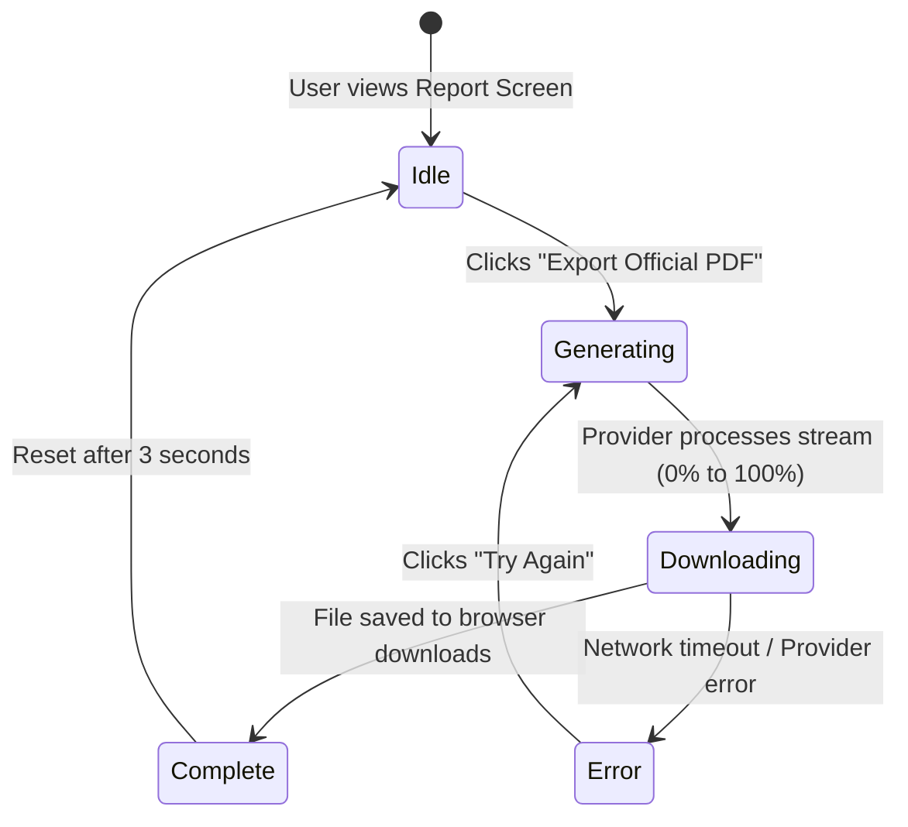

# ScholarX — Phase 3: OBE Analytics & Accreditation Reports

**Target Scope:** Outcome-Based Education (OBE) Configuration, CO/PO Matrix Mapping, Class Analytics Dashboard, AI Pedagogical Recommendations, and NBA/NAAC Accreditation PDF Report Export.  
**Deliverable:** Full accreditation intelligence suite with interactive data visualizations operating against Mock Data.  
**Primary Routes:** `/mentor/classes/:classId/outcomes`, `/mentor/classes/:classId/analytics`, `/mentor/reports`  

---

## 1. Feature Specifications

### 1.1 CO / PO Outcome Configuration Matrix (`/mentor/classes/:classId/outcomes`)

ScholarX complies with international **Outcome-Based Education (OBE)** frameworks (NBA, ABET, NAAC). Mentors configure how assessments map to Course Outcomes (CO1–CO6) and Program Outcomes (PO1–PO4).

#### 1.1.1 Course Outcomes (CO) Configuration

Faculty define the target learning objectives and weightages:

```text
┌────────────────────────────────────────────────────────────────────────────────────────┐
│ Course Outcome Configuration: CS401 Distributed Systems           Total Weightage: 100% │
├────────────────────────────────────────────────────────────────────────────────────────┤
│ Code  Description                                   Bloom Target    Weight  Status     │
├────────────────────────────────────────────────────────────────────────────────────────┤
│ CO1   Understand distributed system architecture    Understand (L2)   15%   [Valid ✓]  │
│ CO2   Analyze RPC and message-passing protocols     Analyze (L4)      20%   [Valid ✓]  │
│ CO3   Implement distributed consensus (Paxos/Raft)  Apply (L3)        25%   [Valid ✓]  │
│ CO4   Evaluate fault tolerance and replication      Evaluate (L5)     15%   [Valid ✓]  │
│ CO5   Design distributed key-value storage          Create (L6)       15%   [Valid ✓]  │
│ CO6   Assess cloud-native distributed microservices Evaluate (L5)     10%   [Valid ✓]  │
└────────────────────────────────────────────────────────────────────────────────────────┘
```

- **Validation Rule**: The UI provides a live calculation counter. If the sum of weights is $\ne 100\%$, an amber banner alerts the faculty: *"Total weightage must equal exactly 100% (Current: 90%)"*.

#### 1.1.2 CO-to-PO Mapping Matrix

Faculty assign correlation strengths between Course Outcomes and Program Outcomes:
- `1` = Low / Slight Correlation
- `2` = Moderate Correlation
- `3` = High / Substantial Correlation
- `-` = No Direct Correlation

---

### 1.2 Class Analytics Dashboard (`/mentor/classes/:classId/analytics`)

Displays real-time attainment statistics derived from completed student assessments.

#### 1.2.1 KPI Performance Metrics Cards

```text
┌─────────────────┐ ┌─────────────────┐ ┌─────────────────┐ ┌─────────────────┐
│  AVERAGE SCORE  │ │  HIGHEST SCORE  │ │    PASS RATE    │ │ COMPLETION RATE │
│      74.2%      │ │      98.0%      │ │      88.5%      │ │      94.1%      │
│  +3.4% vs last  │ │ Top: Rahul S.   │ │ Threshold: 50%  │ │ 48/51 submitted │
└─────────────────┘ └─────────────────┘ └─────────────────┘ └─────────────────┘
```

#### 1.2.2 Visual CO Attainment Progress Visualizer

Compares student performance against the target institutional benchmark (e.g., 70% threshold):

```text
CO1 (Architecture)    ████████████████████████ 82%  [Target Exceeded]
CO2 (RPC Protocols)   ███████████████████ 68%       [Near Benchmark]
CO3 (Consensus)       ██████████████████████ 76%    [Target Exceeded]
CO4 (Fault Tolerance) ███████████ 48%               [⚠️ ATTAINMENT GAP]
CO5 (Storage Design)  ████████████████ 62%          [Near Benchmark]
CO6 (Cloud Native)    ███████████████████ 71%       [Target Exceeded]
                      ────────────────────▲
                                     70% Target
```

---

### 1.3 Failure Hotspots & AI Pedagogical Recommendations

ScholarX automatically flags learning topics where student comprehension drops below target thresholds, presenting actionable remediation cards:

```text
┌────────────────────────────────────────────────────────────────────────────────────────┐
│ ⚠️ ATTENTION REQUIRED: Remediation Recommended for CO4                                  │
├────────────────────────────────────────────────────────────────────────────────────────┤
│ Detected Gap:                                                                          │
│ 24 out of 48 students scored below 50% on Question 4 (Byzantine Fault Tolerance).       │
│                                                                                        │
│ ✨ ScholarX Pedagogical Recommendation:                                                │
│ "Students struggled with consensus in partitioning scenarios.                          │
│ Suggested Remedial Steps:                                                              │
│ 1. Schedule a 20-minute recap drill focusing on Quorum voting and split-brain scenarios.│
│ 2. Use the ScholarX AI Generator to create a 3-question formative drill for CO4.       │
│                                                                                        │
│ [ ✨ Generate Remedial Drill ]                 [ Dismiss Notice ]                      │
└────────────────────────────────────────────────────────────────────────────────────────┘
```

---

### 1.4 Accreditation Reports & PDF Export UI (`/mentor/reports`)

Mentors can generate formal accreditation dossiers suitable for submission to university inspection boards.

#### Available Report Types
1. **Class Comprehensive Dossier**: Class syllabus, student roster, grade distribution, and CO/PO attainment matrix.
2. **Outcome Attainment Certificate**: Detailed breakdown of individual and aggregate attainment per outcome.
3. **Assessment Performance Breakdown**: Question-by-question statistical difficulty and Bloom taxonomy spread.

#### PDF Export User Experience Flow



- **Architectural Boundary**: The frontend **does not render the PDF via heavy client libraries** (e.g. `jspdf`). It delegates to the backend export endpoint (`GET /api/v1/classes/:id/report/pdf`). The frontend orchestrates the progress bar, toast notification, and retry states.

---

## 2. TypeScript Domain Models

```typescript
// src/app/core/models/analytics.model.ts
export interface CourseOutcome {
  id: string;
  code: string; // e.g. "CO1"
  description: string;
  bloomTarget: string;
  weightagePercentage: number;
}

export interface CoAttainmentMetric {
  coCode: string;
  description: string;
  targetBenchmark: number; // e.g. 70
  actualAttainment: number; // e.g. 76
  status: 'EXCEEDED' | 'MET' | 'BELOW_TARGET';
}

export interface ClassAnalyticsSummary {
  classId: string;
  averageScore: number;
  highestScore: number;
  lowestScore: number;
  passRatePercentage: number;
  completionRatePercentage: number;
  coAttainments: CoAttainmentMetric[];
  hotspots: {
    topic: string;
    coCode: string;
    affectedStudentsCount: number;
    recommendation: string;
  }[];
}
```

---

## 3. Phase 3 Acceptance Criteria

- [ ] CO weightage form prevents invalid saving if sum $\ne 100\%$, providing clear user feedback.
- [ ] CO-to-PO matrix renders responsive inputs supporting correlation values (0, 1, 2, 3).
- [ ] Analytics dashboard renders KPI summary cards with upward/downward trends.
- [ ] Attainment bars visually differentiate between exceeded, met, and below-target status.
- [ ] Failure hotspot cards display AI recommendations with a direct button to trigger the AI Generator.
- [ ] PDF Export button simulates realistic progress states (Preparing document ➔ Compiling ➔ Complete) with error handling.
