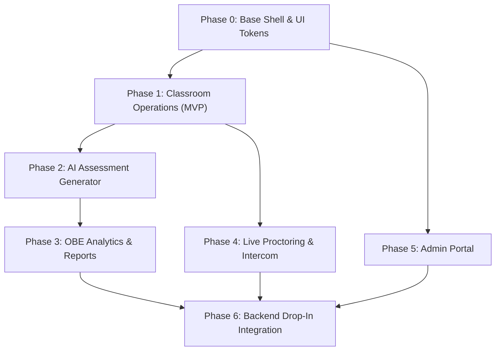

# ScholarX — Phased Architecture & Documentation Walkthrough

We have divided the comprehensive 1839-line PRD for the **ScholarX** Mentor & System Administrator Web Frontend into **7 modular, sequential phases**. 

All phase documents have been authored and verified. They strictly adhere to your requirements:
1. **Frontend-Only Scope**: Zero backend or database implementation.
2. **Pluggable Mock API Provider**: Complete decoupling using the `DataProviderInterface` pattern so the frontend can later connect to the real FastAPI backend with zero component rework.
3. **ScholarX Branding & Professional UI**: Defined the modern academic color palette (Deep Indigo, Electric Sky, Nebula Purple, and Clean Slate) along with responsive layouts and UI states.

---

## 1. Documentation Artifacts Index

The complete documentation suite is available in the following artifacts:

| Phase | Specification Document | Key Modules Covered |
| :--- | :--- | :--- |
| **Phase 0** | [Phase 0: Foundation & Design System](file:///C:/Users/sahil/.gemini/antigravity/brain/69325728-56a6-4814-9210-ed2cfa27a4ef/phase-0-architecture-and-design-system.md) | Angular 18 Standalone Architecture, Directory Tree, Deep Indigo Color Palette, UI Tokens, `DataProviderInterface` & Mock Provider abstraction. |
| **Phase 1** | [Phase 1: Mentor Core & Classroom Operations](file:///C:/Users/sahil/.gemini/antigravity/brain/69325728-56a6-4814-9210-ed2cfa27a4ef/phase-1-mentor-core-and-classes.md) | Mentor Dashboard KPIs, Class CRUD, Tabbed Class Workspace, Student Roster, and Enrollment Queue (Approve/Reject modals). |
| **Phase 2** | [Phase 2: Assessments & AI Test Generator](file:///C:/Users/sahil/.gemini/antigravity/brain/69325728-56a6-4814-9210-ed2cfa27a4ef/phase-2-assessments-and-ai-generator.md) | Assessment Lifecycle, Question Editor, ScholarX AI Test Generator Wizard, Bloom's Taxonomy & CO/PO tags, In-Place Single-Question Regeneration, and Publishing checklist. |
| **Phase 3** | [Phase 3: OBE Analytics & Accreditation Reports](file:///C:/Users/sahil/.gemini/antigravity/brain/69325728-56a6-4814-9210-ed2cfa27a4ef/phase-3-obe-analytics-and-reports.md) | Course Outcomes (CO1–CO6) Weightage Matrix, CO-to-PO Correlation Table, Class Attainment Visualizer, AI Pedagogical Recommendations, and PDF Export UI. |
| **Phase 4** | [Phase 4: Live Proctoring & Realtime Communication](file:///C:/Users/sahil/.gemini/antigravity/brain/69325728-56a6-4814-9210-ed2cfa27a4ef/phase-4-live-proctoring-and-communication.md) | Candidate Video Grid, Proctoring Alert Taxonomy (Tab Switch, Face Absent), Candidate Focus Inspector, Mentor Intercom, Notification Center, and Class Chat. |
| **Phase 5** | [Phase 5: System Administration Portal](file:///C:/Users/sahil/.gemini/antigravity/brain/69325728-56a6-4814-9210-ed2cfa27a4ef/phase-5-admin-portal.md) | Global Administrative KPIs, Unified User Directory (Students, Mentors, Admins), Multi-Institution Directory, Onboarding Wizard, and Audit Logs. |
| **Phase 6** | [Phase 6: Backend Contract & Mock Data Specification](file:///C:/Users/sahil/.gemini/antigravity/brain/69325728-56a6-4814-9210-ed2cfa27a4ef/phase-6-backend-contract-and-mock-spec.md) | Complete FastAPI REST Endpoint Mapping (30+ endpoints), DTO Schemas, Realistic Academic Mock Fixtures corpus, and the single-line cutover blueprint. |

---

## 2. Unlocking `D:\mentor-frontend` Write Permissions

> [!NOTE]
> During file generation, Windows reported that the directory `D:\mentor-frontend` inherits permissions from `D:\` where standard users only have **Read and Execute** permissions.
> 
> To allow files and code to be created directly in `D:\mentor-frontend\docs\` and `D:\mentor-frontend\src\`, please open **Command Prompt** or **PowerShell** as **Administrator** and run this single command:
> 
> ```cmd
> icacls "D:\mentor-frontend" /grant Everyone:(OI)(CI)F /t
> ```
> 
> Once executed, all folders and files will be writable by the workspace tools seamlessly.

---

## 3. Recommended Development Sequencing



1. **Step 1**: Scaffold the Angular 18 application with the standalone `DataProviderInterface` and the ScholarX Deep Indigo design tokens ([Phase 0](file:///C:/Users/sahil/.gemini/antigravity/brain/69325728-56a6-4814-9210-ed2cfa27a4ef/phase-0-architecture-and-design-system.md)).
2. **Step 2**: Implement the faculty classroom dashboard and enrollment approval queue ([Phase 1](file:///C:/Users/sahil/.gemini/antigravity/brain/69325728-56a6-4814-9210-ed2cfa27a4ef/phase-1-mentor-core-and-classes.md)).
3. **Step 3**: Build the ScholarX AI Assessment Generator with Bloom's taxonomy tags and single-question regeneration ([Phase 2](file:///C:/Users/sahil/.gemini/antigravity/brain/69325728-56a6-4814-9210-ed2cfa27a4ef/phase-2-assessments-and-ai-generator.md)).
4. **Step 4**: Construct the OBE Analytics and Accreditation Export screens ([Phase 3](file:///C:/Users/sahil/.gemini/antigravity/brain/69325728-56a6-4814-9210-ed2cfa27a4ef/phase-3-obe-analytics-and-reports.md)).
5. **Step 5**: Build the Live Proctoring Grid with Alert badges and Mentor Intercom ([Phase 4](file:///C:/Users/sahil/.gemini/antigravity/brain/69325728-56a6-4814-9210-ed2cfa27a4ef/phase-4-live-proctoring-and-communication.md)).
6. **Step 6**: Assemble the System Admin portal for campus governance ([Phase 5](file:///C:/Users/sahil/.gemini/antigravity/brain/69325728-56a6-4814-9210-ed2cfa27a4ef/phase-5-admin-portal.md)).
7. **Step 7**: Share [Phase 6](file:///C:/Users/sahil/.gemini/antigravity/brain/69325728-56a6-4814-9210-ed2cfa27a4ef/phase-6-backend-contract-and-mock-spec.md) with your backend teammates to coordinate the FastAPI endpoint contracts.
